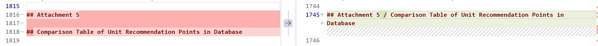
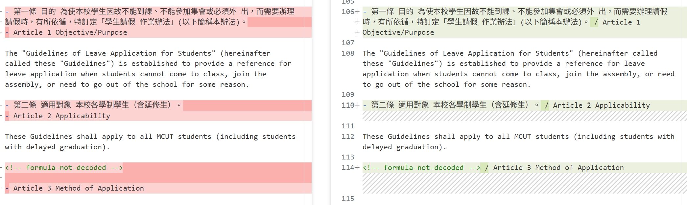
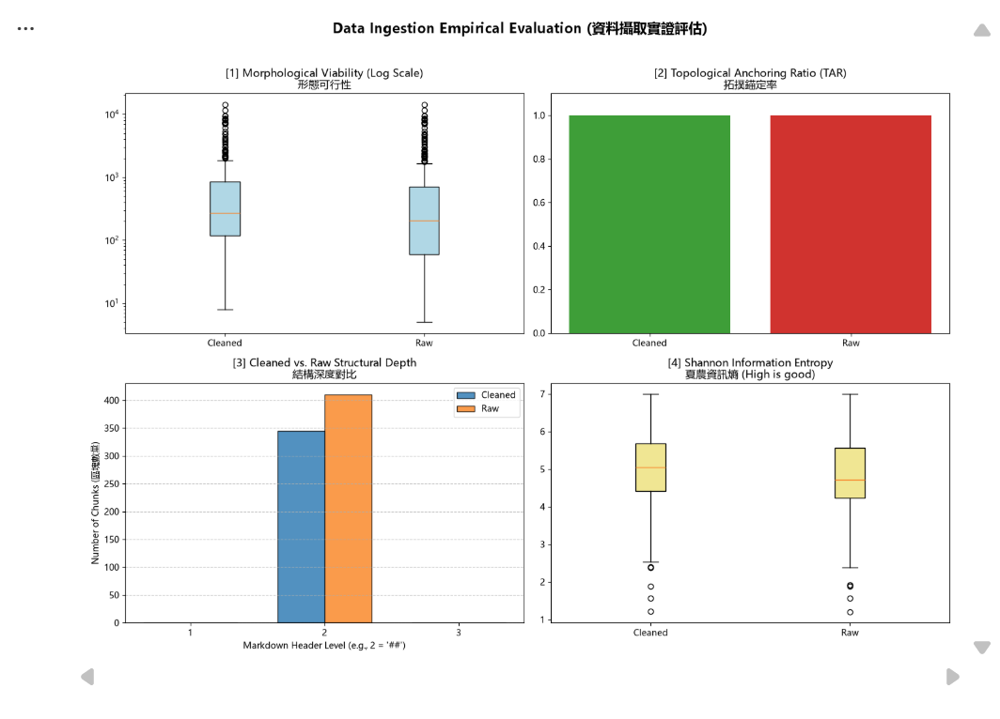

# 資料前處理報告 (Data Preparation Report)

> 期中評量 · NLP 自然語言處理 115-S1
> 填寫方式：請把所有「（ ）」與 `___` 替換成你自己的內容，並刪除 `>` 開頭的說明文字。

- **學號 / 姓名**：U12672006
- **專案名稱**：weiwei726726
- **完成的任務**：- [ ] 1-A 頁首頁尾清除　- [ ] 1-B 雙語標題合併　- [ ] 1-C 雙語條文合併

---

## 1. 資料集概覽 (Dataset Overview)

> 數字來源：`01_Data_Ingestion.ipynb` 第 2 節 (掃描 PDF) 與第 5 節 (批次處理) 的輸出。

| 類別 (Cluster) | PDF 數量 | 清洗前 chunk 數 | 清洗後 chunk 數 |
|---|---|---|---|
|Academic_Affairs|3|96|65|
|Library_Information|3|248|225|
|Student_Affairs|3|66|55|
| **合計** |9|410|345|

**問題 (2–3 句)：** 清洗後 chunk 數量變少了多少？是哪個任務造成的？有沒有哪個任務**不影響** chunk 數量？為什麼？
1.全部少了65個
2.1-A 刪掉##法規名稱，1-B 把相鄰##併成一個(chunking_regex = r'\n(?=##\s)')
3.1-C
4.只合併-開頭，沒有動到##
> 提示：chunk 是用什麼規則切開的？請看 notebook 第 5 節的 `chunking_regex`。

___

## 2. 清洗步驟 (Cleaning Steps)

> **截圖來源：** `data/interim/<類別>/` 中的 `raw_*.md` (清洗前) 與 `cleaned_*.md` (清洗後)，也就是批次處理存下的**真實檔案**。
>
> **[重要] 不可使用 notebook 中的範例。** notebook 任務 1-A、1-B、1-C 的測試文字 (第二十一條、明志科技大學 / Ming Chi University of Technology、第十五條 / Article 15) **不能**作為你的截圖。請在真實檔案中**另找一處**，可以是其他 PDF 的檔案。使用範例的截圖**不給分**。
>
> **截圖方法 (VS Code 比較檢視)：**
> 1. 在檔案總管對 `raw_<檔名>.md` 按右鍵 → **Select for Compare**。
> 2. 對同一份文件的 `cleaned_<檔名>.md` 按右鍵 → **Compare with Selected**。
> 3. 左右並排顯示，紅色 = 刪除，綠色 = 新增或修改。按 `Ctrl + F` 搜尋，找到該任務造成的變更。
> 4. 每個任務截**一張**圖，存到 `reports/figures/`，**檔名必須完全相同** (否則圖片不會顯示)：
>    * 任務 1-A → `1a_compare.png`
>    * 任務 1-B → `1b_compare.png`
>    * 任務 1-C → `1c_compare.png`

### 2.1 任務 1-A：頁首頁尾溢出清除

- 檔名：raw_A242060013_學生請假作業辦法 搜尋的文字：## 學生請假作業辦法
- 截圖 (存為 `reports/figures/1a_compare.png`)：
- 改變了什麼：##學生請假作業辦法接##Guidelines of Leave Application for Students。清洗後，中文被整行刪除，只剩英文標題。
- 這對之後的問答檢索有什麼幫助：刪除溢出的法規名稱行，避免錯誤切塊，使 chunk 更完整、檢索更準確。
- 這個任務有沒有**改錯**的地方 (把不該改的也改了)？若有，寫出檔名與搜尋的文字；若沒有，寫「沒有發現」：有，誤刪真正的中文標題，導致中文搜尋命中減少，後續 chunk 也遺失中文標題資訊。

### 2.2 任務 1-B：雙語標題合併

- 檔名：raw_A271010023_圖書館管理作業規範　搜尋的文字：Attachment 5
- 截圖 (存為 `reports/figures/1b_compare.png`)：
- 改變了什麼：清洗前有兩個相鄰標題，清洗後合併為單一標題，以「/」連接。 
- 這對之後的問答檢索有什麼幫助：合併標題使編號與表名同屬一個 chunk
- 這個任務有沒有**改錯**的地方 (把不該改的也改了)？若有，寫出檔名與搜尋的文字；若沒有，寫「沒有發現」：沒有發現

### 2.3 任務 1-C：雙語條文合併

- 檔名：raw_A242060013_學生請假作業辦法　搜尋的文字：Article 1 Objective/Purpose
- 截圖 (存為 `reports/figures/1c_compare.png`)：
- 改變了什麼：清洗前中英文條文分列，清洗後合併一行，以「/」連接並移除英文項目符號。
- 這對之後的問答檢索有什麼幫助：中英條文合併同一 chunk，提升雙語檢索命中率，減少無上下文片段
- 這個任務有沒有**改錯**的地方 (把不該改的也改了)？若有，寫出檔名與搜尋的文字；若沒有，寫「沒有發現」：僅合併英文標題，英文內文仍獨立，造成中英條文對照不完整。

## 3. 評估指標與 AI 解讀查證 (Metrics & Verifying the AI's Interpretation)

### 3.1 指標數據表

> 數字來源：專案根目錄的 `metrics.json`。[1]、[2] 必填；[3]、[4] 選填。
> 「參考值」由老師在課堂上公布 (完成全部任務的結果)。

| 指標 | Raw | Cleaned (你的) | Cleaned (參考值) |
|---|---|---|---|
| [1] 中位數長度 Median Length |204.0|272|270.5|
| [2] 拓撲錨定率 TAR |100%|100% |100% |
| [3] 深度變異量 SDV (選填) |0|0|0|
| [4] 中位數資訊熵 Entropy (選填) |4.71|5.05|5.06|

> **儀表板截圖：** 你自己的 `01_Data_Ingestion.ipynb` **第 6 節**輸出的 4 拼圖儀表板 (第 8 週執行並保留的輸出)。截圖後存為 `reports/figures/dashboard.png`。第 3.2 節也會用到這張截圖。



你的 Cleaned 結果與參考值一致嗎？若一致，寫「一致」；若不一致，找出原因。（1 句）
一致
___

### 3.2 AI 的解讀

> 把第 3.1 節的儀表板截圖 (`dashboard.png`) 交給 AI，請它解讀結果。將 AI 的回答**完整貼在這裡**，並註明使用的 AI 工具。

- 使用的 AI 工具：claude

```text
整體結論： 清洗讓資料集變小、變整齊，但這四張圖裡，真正能證明清洗有效的只有 [1]、[3]、[4]。[2] 看不出差異，[3] 主要只反映 chunk 數量下降。

[1] 形態可行性（長度，對數座標）

Cleaned 的中位數約 270 字元，Raw 約 200 字元，整個箱型往上移。Cleaned 的最小值（約 8）也比 Raw（約 5）大。
這表示很短的碎片 chunk 變少，推測是只有標題或只有幾個字的 chunk 被合併或消失。
兩邊都有一批很長的離群點，最高接近 10⁴ 字元，而且位置幾乎一樣。這表示清洗沒有處理過長 chunk，它們可能是大型表格或沒有標題切點的長段落。這些在檢索時可能造成主題稀釋。

[2] 拓撲錨定率 TAR

兩邊都是 1.0，沒有差異。
只能說所有 chunk 都以 # 標題開頭，但無法用它判斷清洗好壞。這個指標在此幾乎沒有區分力。

[3] 結構深度

所有 chunk 都在深度 2（##），深度 1 和 3 都是 0，所以變異量是 0。
Cleaned 約 345 個，Raw 約 410 個，大約少 16%，表示標題合併和頁首頁尾清除減少了 chunk 數。
解析和切塊只產生單一層級，沒有辨識出條、款、項的巢狀結構。

[4] 資訊熵

Cleaned 的中位數約 5.05，Raw 約 4.7，整體略高，表示 chunk 的內容更密。
兩邊下方都有一些熵約 1.2 到 2.5 的離群點，內容重複性很高，可能是表格的空白、分隔線、| 等符號。

小結

清洗的效果：碎片變少、中位數變長、熵略升。
清洗沒有解決的問題：極長的 chunk、低熵的 chunk、沒有層級結構。
圖只能看到整體趨勢，不能看到具體哪些 chunk 被改對或改錯，要回到檔案檢查。
```

### 3.3 你的查證 (至少兩點)

> 挑 AI 說得最肯定的兩句話，回到你的檔案或程式中找證據：它說的是真的嗎？

**查證 1**
- AI 的說法：TAR 兩邊都是 1.0，只能說所有 chunk 都以 # 標題開頭，但無法用它判斷清洗好壞。這個指標在此幾乎沒有區分力。
- 我查了什麼 (哪個檔案、哪個 chunk、哪段程式)：#  前切分 chunk，因此除首段外，每個 chunk 均以 ## 開頭。
- 結論：正確 ，因為 TAR 100% 是切塊規則必然結果，清洗前後無差異，無法證明品質改善。

**查證 2**
- AI 的說法：所有chunk都在深度 2（##），深度 1 和 3 都是 0，所以變異量是 0。解析和切塊只產生單一層級，沒有辨識出條、款、項的巢狀結構。
- 我查了什麼：統計 chunk 首標題，結果必為2、變異數為0；另搜尋確認原始檔層級分布。
- 結論： 部分正確，因為 深度全為2、SDV=0屬實，但主因是切塊規則與指標限制，須依搜尋結果判斷解析器是否辨識巢狀標題。
### 3.4 實際證據：你被指定的 chunk

> 執行 `09_midterm_chunks.ipynb`：填入你的學號與老師在課堂上公布的 SEED，按 Run All。
> 每位同學拿到的 chunk 不同。請**連同驗證碼**一起填入。
> 程式只顯示前 400 字元的預覽。請在 VS Code 打開程式列出的**閱讀用檔案** (`data/interim/` 中的 `cleaned_*.md`，與 JSON 內容相同但有正常換行)，按 `Ctrl + G` 輸入程式給的**行號** (或按 `Ctrl + F` 搜尋「搜尋用」文字)，從該行讀到下一個 `## ` 標題為止，就是**完整**的 chunk。

- **SEED**：1106

**(a) 很長的 chunk**
- 資料檔 (JSON)：data/processed/Academic_Affairs/cleaned_A232060013_學生抵免學分辦法_processed.json　位置：第 25 個 (從 0 開始數)　長度：4367 字元　驗證碼：61b282ca
- 閱讀用檔案 (`.md`)：data/interim/Academic_Affairs/cleaned_A232060013_學生抵免學分辦法.md　從第 277 行開始
- 前 3 行內容：
  ```text
  ## 明 志 科 技 大 學 學 分 抵 免 申 請 書 Ming Chi University of Technology Credit Transfer Application Form
  [ ] □博士班 □碩士班 □四技部
  ```
- 這是什麼樣的文字？為什麼會這麼長？缺乏標題切點，整張表被合併為4367字元的單一chunk。
- 之後做問答檢索時，這麼長的 chunk 可能造成什麼問題？表格被切壞或欄位錯位，會讓 LLM 讀不懂欄位之間的對應。

**(b) 資訊熵很低的 chunk**
- 資料檔 (JSON)：data/processed/Library_Information/cleaned_A273060005_學生電子郵件帳號管理要點_processed.json　位置：第 3 個 (從 0 開始數)　資訊熵：2.58　驗證碼：2248
- 閱讀用檔案 (`.md`)：data/interim/Library_Information/cleaned_A273060005_學生電子郵件帳號管理要點.md　從第 33 行開始
- 內容：
  ```text
## 目錄 / Table of contents

|                                                   |                                                   |   頁次 Page Number |
|---------------------------------------------------|---------------------------------------------------|--------------------|
| 第一條                                            | 目的                                              |                  1 |
| Article 1 Purpose                                 | Article 1 Purpose                                 |                  1 |
  ```
- 為什麼它的資訊熵這麼低？它對問答檢索有用嗎？符號重複使資訊熵偏低，內容疑似目錄列，缺乏實質資訊且易誤命中。

## 4. 一個尚未解決的問題 (One Remaining Problem)

> 打開 `data/interim/` 中任一個 `cleaned_*.md` (與 `data/processed/` 的 JSON 內容相同，但有正常換行，比較好讀)，找出一個清洗後**仍然有問題**的 chunk。
> 每個 chunk 從一個 `## ` 標題開始，到下一個 `## ` 標題之前結束。
> 例如：只有標題沒有內文、表格亂掉、中英文沒有對齊、還有殘留的頁首頁尾、斷行造成的多餘空白，或是**清洗造成的錯誤** (誤合併、誤刪除)。
> **不可**使用第 3.4 節的兩個 chunk。

- **檔名** (`cleaned_*.md`)：cleaned_A271010023_圖書館管理作業規範.md　**從第 1745 行開始** (VS Code 左側的行號)　**標題**：## Attachment 5 / Comparison Table of Unit Recommendation Points in Database
- **我是怎麼找到的** (例如：搜尋了什麼、看了哪個檔案)：第6.1節找出最長chunk為附件5，長14350字元、熵1.21，位於cleaned第1745行。
- **問題 chunk (貼上部分內容)**：貼你在第 1745 行往下看到的前十幾行。

```text
|          |  1 |                         140 | 140 140                     | 140                         |                         140 |                         120 |                               | 105                         |                      93 | 84                          |                           76 |                           70 |                           65 |                           60 |                           56 |                         52.5 |
|          |  2 |                             | 112                         | 112 112                     |                         112 |                             |                           100 | 90                          |                      82 | 75                          |                           69 |                           64 |                           59 |                           55 |                           52 |                           49 |
|          |  3 |                             |                             | 84                          |                          84 |                          84 |                            80 | 75                          |                      70 | 65                          |                           61 |                           57 |                           54 |    
```

- **問題是什麼**：超大表格長達14350字元，欄位重複、符號密集，資訊熵僅1.21。
- **可能的原因** (PDF 本身？Docling 轉換？清洗的正則表示式？切塊規則？)： 只認 ## ，表格內部沒有標題，所以整張表無法被切開。
- **具體的修正方法** (例如：一條規則、一個正則表示式的構想、長度上限)：長 chunk 依表格列拆分，保留表頭與標題，並新增 table 類型。
- **對問答檢索的影響**：重複欄位稀釋向量，增加檢索失準、Token 浪費及表格誤讀風險。

## 5. AI 協作 (AI Collaboration)

- 本次作業的 AI 協作紀錄請見 [`AI_USAGE.md`](AI_USAGE.md) 的「Week 04 / 08」與「Week 09」段落。
- 這次使用 AI 最大的收穫或教訓是 快速插出關鍵查詢點和思考方式（請具體：例如提示詞中哪一段最關鍵、AI 哪一句解讀不正確）
